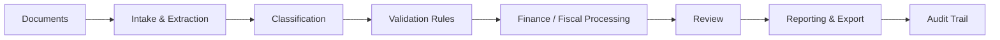

# Finance & Accounting Automation — Case Study

> Sanitized portfolio case study. Financial records, production data, credentials, and private source code are not published.

## Business Need

Recurring finance and accounting work creates risk when documents, calculations, approvals, and monthly follow-up are handled through disconnected files or manual steps.

## Objective

Create a structured workflow that moves documents from intake to review, validation, calculation, reporting, and auditability.

## Workflow

## Scope

- Purchase, sales, expense, bank, and payroll document flows
- AI-assisted extraction and classification
- Validation and reconciliation checks
- Monthly fiscal/declaration workflows
- Payroll and employee synchronization
- PDF and reporting outputs
- Role-aware settings
- Traceable audit-oriented actions

## My Contribution

- Map accounting and operational requirements into application workflows
- Define validation rules and exception handling
- Structure document states and review logic
- Connect finance requirements to data structures and user interfaces
- Test critical calculations and workflow transitions
- Maintain privacy boundaries between portfolio material and production information

## Technology

React · TypeScript · Supabase · PostgreSQL · Vitest · Playwright · AI-assisted document processing

## What This Demonstrates

**Requirements analysis · finance operations · document automation · validation logic · traceability · QA · AI-assisted workflows**
